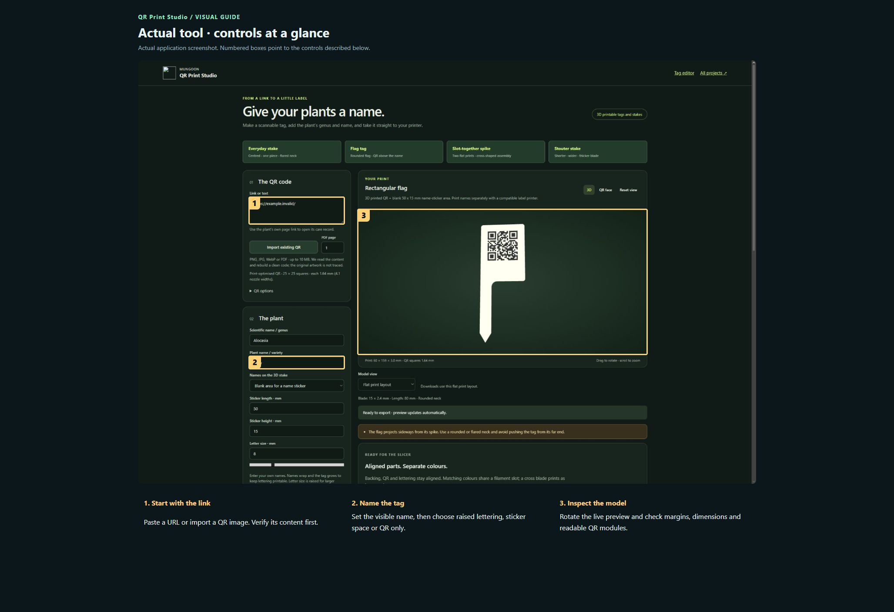
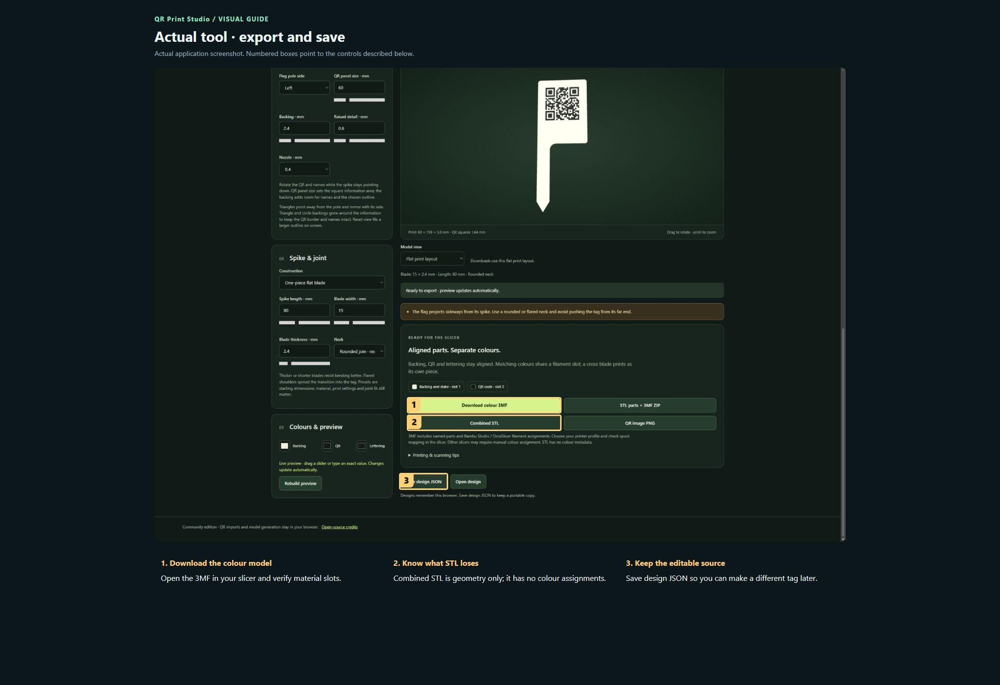
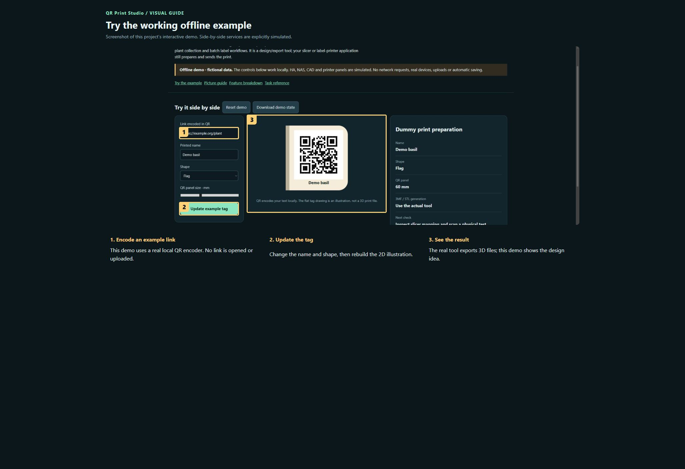

# QR Print Studio

**Maintaining this project? [Start here](docs/START-HERE.md) · [Detailed handover](docs/HANDOVER.md)**

Design readable QR tags and plant labels for 3D printing. Start with a URL or an existing QR image, add names, choose a stake or flat-tag shape, and export printable bodies. The hosted edition can also use the plant collection and batch label workflows. It is a design/export tool; your slicer or label-printer application still prepares and sends the print.

[Publication checks and remaining limits](docs/PUBLICATION.md)

**Public source preview · MIT for original contributions.**

[Open the visual manual](docs/USER-MANUAL.md) · [Download the self-contained demo](demo.html) · [Release notes](CHANGELOG.md)

Download `demo.html` using GitHub’s Download raw file control, then open it in your browser. GitHub displays HTML source; it does not run the demo on this page. The demo is an offline simulation with fictional data and makes no network requests.

## See it

### Actual tool · controls at a glance

Actual application screenshot. Numbered boxes point to the controls described below.

1. **Start with the link.** Paste a URL or import a QR image. Verify its content first.
2. **Name the tag.** Set the visible name, then choose raised lettering, sticker space or QR only.
3. **Inspect the model.** Rotate the live preview and check margins, dimensions and readable QR modules.

### Actual tool · export and save

Actual application screenshot. Numbered boxes point to the controls described below.

1. **Download the colour model.** Open the 3MF in your slicer and verify material slots.
2. **Know what STL loses.** Combined STL is geometry only; it has no colour assignments.
3. **Keep the editable source.** Save design JSON so you can make a different tag later.

### Try the working offline example

Screenshot of this project’s interactive demo. Side-by-side services are explicitly simulated.

1. **Encode an example link.** This demo uses a real local QR encoder. No link is opened or uploaded.
2. **Update the tag.** Change the name and shape, then rebuild the 2D illustration.
3. **See the result.** The real tool exports 3D files; this demo shows the design idea.

## What this tool does

| Feature | What it lets you do | Where |
| --- | --- | --- |
| QR input | Generate from a link or decode PNG, JPG, WebP and PDF QR artwork. | Standalone + hosted |
| Tag layouts | Combine QR and names; rotate content and choose a centred stake, left/right flag or flat tag. | Both |
| Geometry controls | Adjust blade, neck and label dimensions and preview the resulting geometry. | Both |
| Slotted spikes | Create two blades that slot together; export a small fit test before the full design. | Both |
| Colour-aware exports | Export 3MF or aligned STL bodies so the slicer can assign materials to the intended regions. | Both |
| Plant collection | Search plants, retain per-plant settings and preview/export selected tags on multiple plates. | Hosted |
| Name stickers | Set actual label-roll dimensions, padding, type size and printer resolution; export PDF or an Excel name batch. | Hosted |

## A first useful workflow

### Make your first QR tag

1. Paste an ordinary demonstration URL into the QR input. If importing artwork, choose a clear image or PDF and verify the decoded link before designing around it.
2. Enter a short readable name; add a scientific name only if useful. Choose a starting layout and tag type.
3. Set overall dimensions, label placement and content rotation. Refresh the preview and check that lettering, QR modules and margins remain distinct.
4. Export a colour 3MF, open it in your slicer and assign the intended filament colours. Verify size and part placement before slicing.
5. Print one test tag and scan the physical result. A successful model export does not demonstrate that your print is optically readable.

## Saving and outputs

Standalone settings remain in this browser and can be saved as portable design JSON. Hosted collection settings are saved per plant on the NAS. Keep the editable JSON and the intended URL with your exported print files; STL/3MF output is not a replacement for the editable design.

## Running the actual tool

python -m http.server 8765 --bind 127.0.0.1; then open /projects-host/site/qr-studio/

The demo has no prerequisites; the real tool may need the services described in the manual and retained source notes.

## Current boundaries

A browser preview and valid 3MF archive have been checked. Physical printing, scanning and the full range of printers/materials remain separate checks. The standalone export has no connected plant catalog or NAS batch service.

## Licence and sharing

MIT applies to original project contributions. Bundled/upstream software and assets retain their own terms; see [third-party notes](THIRD-PARTY.md). Keep this repository private until its own [release checklist](RELEASE-CHECKLIST.md) is complete and the owner authorises publication.
